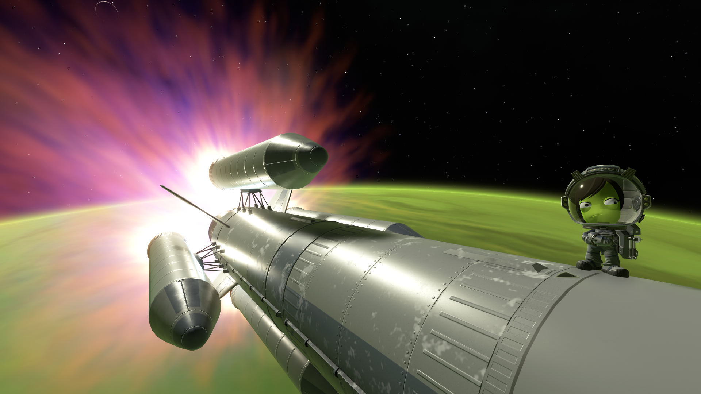
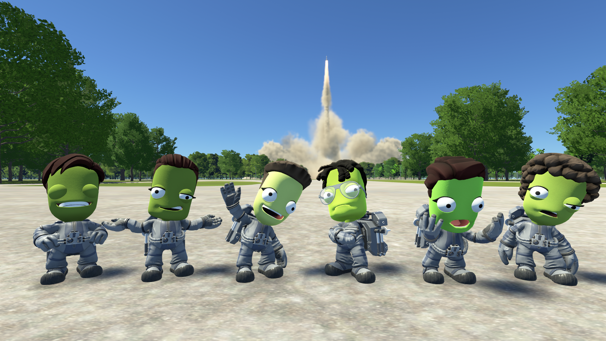
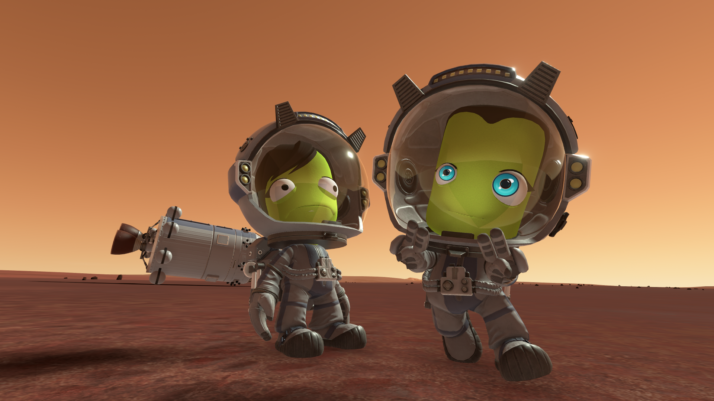
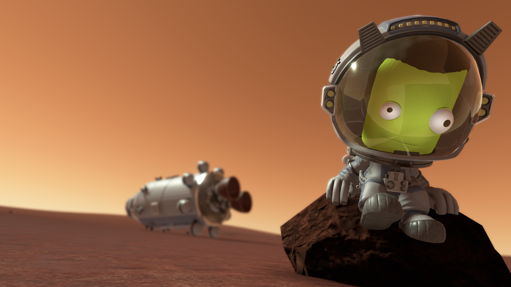
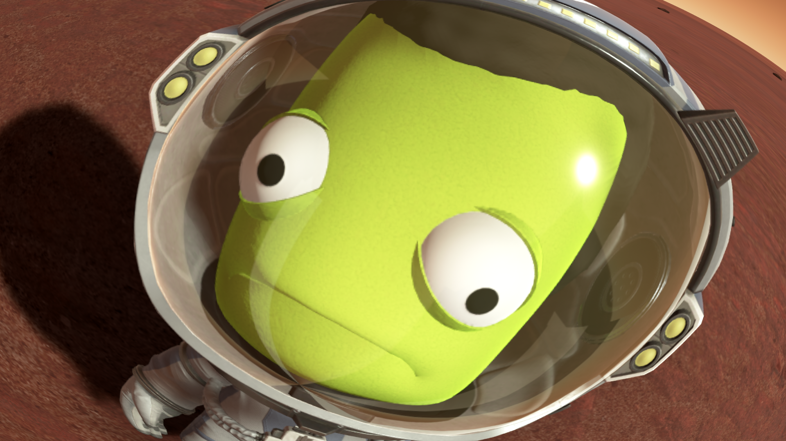
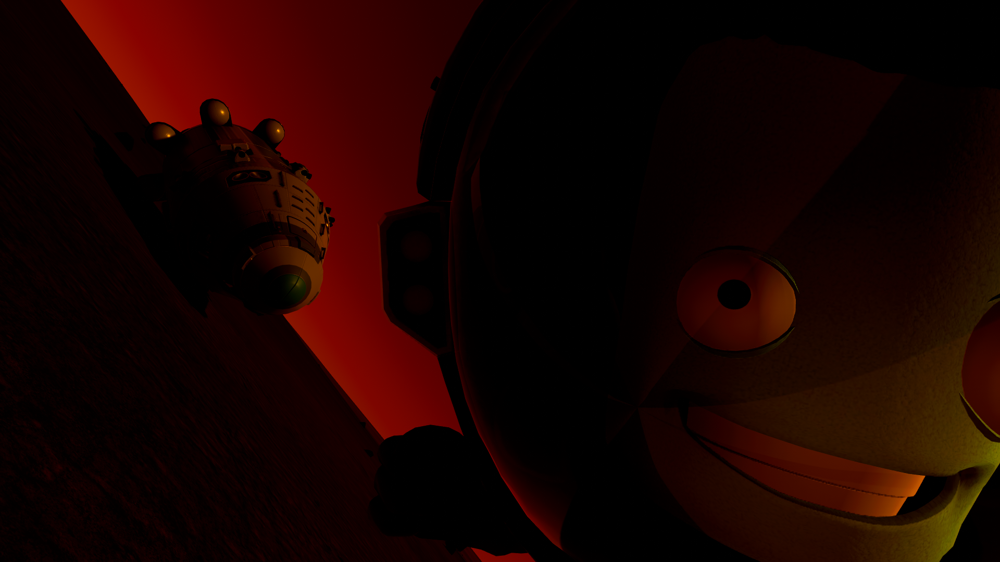
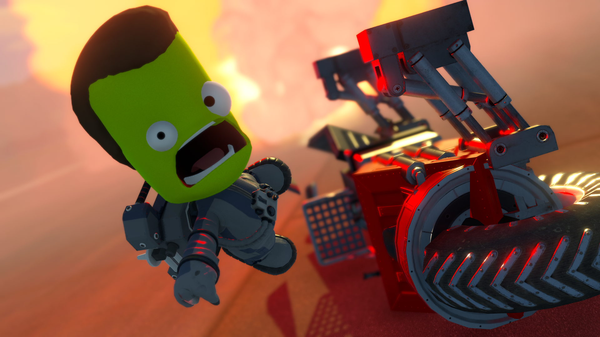
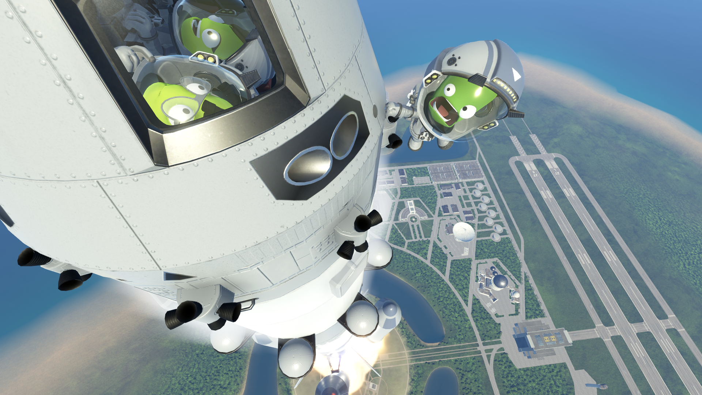
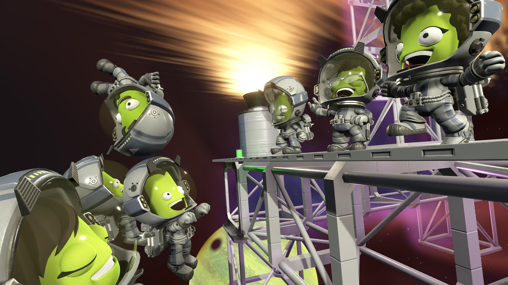
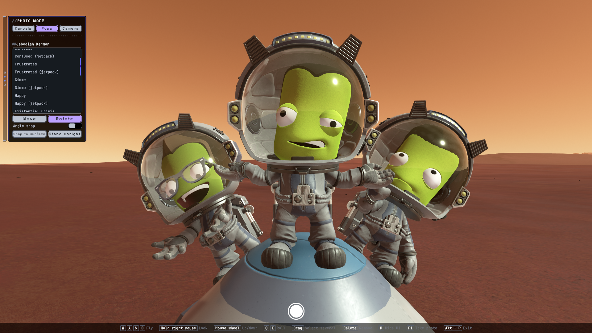

# MunShot

**A photo mode for [KSP2 Redux](https://github.com/KSP2Redux/Redux).** Pause the game, bring any kerbal into the shot, pose them, frame it with a free or orbiting camera, and take the picture.

> 🚧 Pre-release (0.3.0): early, but working. Please report problems on the [issues page](https://github.com/BillMeabrod/MunShot/issues).

## What it does

- **Photo mode.** Open it in flight from Redux's app tray, the **Photo Mode** button in the pause menu, or **Left Alt+P**. The game pauses and its UI hides; MunShot's own panel sits on the left edge of the screen, with its tabs as icons down its side (hover one for its name).
- **Any kerbal, anywhere.** Bring in kerbals from the scene or from anywhere in your roster. They appear in front of the camera as stand-ins, so the real kerbals are never moved: closing photo mode puts everything back exactly as it was.
- **Poses.** 29 in all: 17 of the game's own animations, held at their best moment, and 12 made for MunShot (Rock on, Anime Girl, Hanging On, Superman, Floating Asleep, Spacewalk Tumble, Thumbs Up, Victory Jump, Running Away, Sitting on the Edge, Dramatic Point and Cheerleader). The **Jetpack** switch picks the ground or jetpack version, and helmets and visors come off with a switch.
- **Placing.** The VAB's own move and rotate handles, with angle snap. Select several kerbals with a drag box or Shift+click and move or turn them together. **Snap to surface** stands them on the ground, **Stand upright** turns them upright on screen, and **Delete** takes them out of the shot.
- **Camera.** Fly freely with WASD and the mouse, holding Shift to pick up speed for long distances, or orbit around your ship or a kerbal. Roll and field of view (up to 140°) are yours to set. Every movement is the camera's own, as in space: left is always left on screen, even rolled or upside down, and **R** brings back a level horizon.
- **Lens.** **Depth of field** blurs what's nearer and further than the focus, with **Focus on selected kerbal** to put them sharp, and a **Fisheye** that bulges the picture like an action camera.
- **Color.** Exposure, contrast, saturation (down to black and white) and warmth, with **Reset** to go back to the game's own picture.
- **Light.** Up to four lights of your own: point or spot, any color, brightness and range, lighting kerbals only or everything. Click a light's marker and move or aim it with the same handles as kerbals; the markers never show in the photo.
- **Taking the photo.** Press **F1** (the game's screenshot key) or the shutter button. Photo mode's UI hides for the shot, and Redux saves it to the game's `Screenshots` folder with your screenshot settings.

*Six kerbals from the roster brought to the launch site for a group photo.*

*The Anime Girl pose on Duna.*

*Depth of field: focused on the kerbal, the capsule behind blurs away.*

*Fisheye: up close, the kerbal's helmet bulges out of the picture.*

*One red light in the dark.*

*Lights and depth of field together.*

*Hanging On, during a launch.*

*A station party above Jool.*

*The photo mode overlay: the panel on the left, the shutter at the bottom, and the keys along the bottom edge.*

## Controls

| Key | In photo mode |
|---|---|
| **Left Alt+P** | Open or close photo mode |
| **W A S D** | Fly the camera |
| **Hold right mouse** | Look around (free camera) or circle the target (orbit camera) |
| **Mouse wheel** | Fly up and down (free camera), or get closer and further (orbit camera) |
| **Q / E** | Roll the camera; **R** levels it again |
| **Shift / Ctrl** | Faster (picking up speed the longer it's held) / slower |
| **Click** a kerbal or a light's marker | Select it to pose or move |
| **Shift+click**, or **drag a box** | Select several kerbals and lights to move together |
| **Drag** a selected kerbal, holding **right mouse** too | Turn them left and right (spot lights too) |
| **Drag** a selected kerbal, holding **Ctrl** | Lean them to the side |
| **Drag** a selected kerbal, holding **Ctrl+Alt** | Tip them forward and back |
| **Delete** or **Backspace** | Take the selected kerbals and lights out of the shot |
| **H** | Hide photo mode's UI to frame the shot |
| **F1** | Take the photo |

All of these can be changed on MunShot's page in the game's settings.

## Requirements

- Kerbal Space Program 2 with [KSP2 Redux](https://github.com/KSP2Redux/Redux) **0.2.9-26w43b or newer**.
- Keyboard and mouse. Gamepads aren't supported yet.

## Installing

1. Download `MunShot.zip` from the [releases page](https://github.com/BillMeabrod/MunShot/releases).
2. Extract it into your game's `mods` folder (`Kerbal Space Program 2\mods\`). It contains a `MunShot` folder, so you end up with `mods\MunShot\`.

## Translations

MunShot is translated into German, French, Italian, Spanish, Japanese, Korean, Polish, Russian, Portuguese (Brazil) and Chinese (Simplified and Traditional). The translations were machine-written and haven't been reviewed by native speakers yet; corrections are very welcome, as an issue or a pull request to [munshot_localization.csv](Assets/MunShot/Copied/localizations/munshot_localization.csv).

## License

[MIT](LICENSE)
